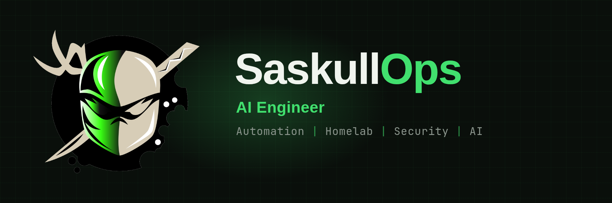

<p align="center">
  
</p>

<h1 align="center">SaskullOps</h1>

<p align="center">
  <strong><code>Automation | Homelab | Security | AI</code></strong>
</p>

<p align="center">
  <a href="https://saskullops.github.io">saskullops.github.io</a>
</p>

<br>

## What is this?

My personal learning notebook. I work in IT, coming from logistics operations, and I use this site to build in public the things I want to understand better: automation, a self-hosted homelab, defensive security and where AI actually helps.

Posts explain what I built and why I made each decision, including what went wrong.

<br>

## Topics

| Area | What you will find |
|---|---|
| **Automation** | n8n, Power Platform, Telegram bots, workflows that run on their own |
| **Homelab** | A Raspberry Pi with Docker, VPN-only access, backups, alerts and GitOps updates |
| **Security** | A home SOC with Wazuh and CrowdSec, hardening, CTF write-ups |
| **AI** | Agents, a model gateway with LiteLLM, tracing and cost control |
| **Product** | QRFleet, a fleet damage reporting app built end to end |

<br>

## Stack

```
Homelab     ->  Raspberry Pi · Docker Compose · Tailscale · Cloudflare Tunnel
Security    ->  Wazuh · CrowdSec · Vaultwarden · Pi-hole
Automation  ->  n8n · Telegram · Power Platform
AI          ->  Hermes Agent · LiteLLM · Ollama · OpenRouter · Langfuse
Product     ->  Next.js · FastAPI · PostgreSQL · Supabase · Hetzner
Workspace   ->  CachyOS · Omarchy · Neovim · tmux · Obsidian · Claude Code
Site        ->  Jekyll · Chirpy theme · GitHub Pages
```

The full, up-to-date list lives in the "Stack en producción" section of the [home page](https://saskullops.github.io).

<br>

## Contact

- **Site:** [saskullops.github.io](https://saskullops.github.io)
- **GitHub:** [@SaskullOps](https://github.com/SaskullOps)
- **Email:** a.guardiola.m@gmail.com

<br>

---

<p align="center">
  <sub>© 2026 SaskullOps · Built in public</sub>
</p>
