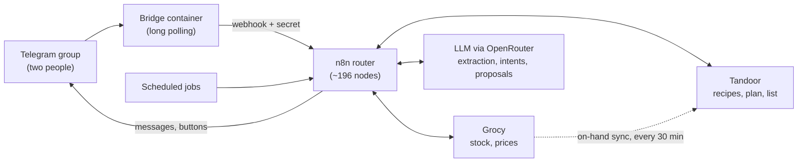
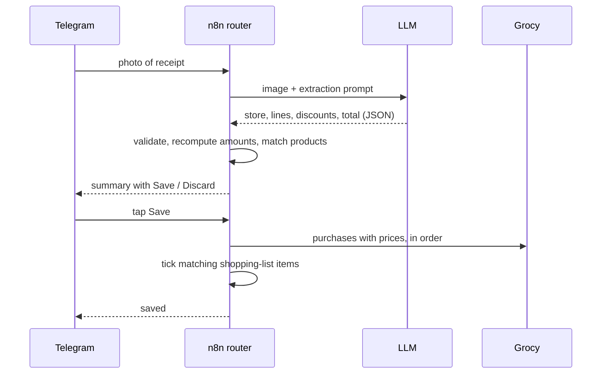

We were throwing food away and still arriving at Thursday without knowing what to cook. The shopping list lived in a notes app, the pantry lived in my head, and every week started with the same negotiation about what to eat.

I wanted one place that knows what is at home, proposes a week of meals, and turns the accepted menu into a shopping list. The constraints made it more interesting than it sounds: self-hosted, cheap to run, and usable by two people who will not open a dashboard. My partner is not going to maintain a pantry database. The interface had to be a Telegram group.

## The pieces

Three open-source tools each do one job, and n8n glues them together.

- **Grocy** owns stock: products, quantities, locations, best-before dates and prices.
- **Tandoor** owns recipes, the meal plan and the shopping list.
- **n8n** holds the logic and talks to both APIs.
- **A small bridge container** polls Telegram and forwards updates to an n8n webhook.

The bridge polls instead of receiving webhooks, so the Pi exposes no inbound port for the bot. It only forwards messages from an allow-list of chats and sends a shared secret header with each request. The web panels of Grocy and Tandoor are reachable only over a VPN.

One rule keeps the system coherent: Grocy is the only writer of stock, and Tandoor only reads what is on hand.

## Flow 1: a photo of a receipt becomes stock

Sending a photo of the ticket to the group is the whole input. A vision-capable model extracts the store, the lines, quantities, discounts and total as structured JSON. The workflow then does the boring parts in code: it creates the store in Grocy if it is new, normalizes package sizes to kg, l or units, and rejects tickets that are not groceries. A restaurant bill gets a clear refusal instead of becoming a pantry entry.

Nothing is written without confirmation. The bot replies with a summary and buttons, and a text message such as "the yogurt was 4 units" corrects the pending ticket before it is saved.

The same call handles a photo of groceries without an itemised ticket, using the caption total to split estimated prices. It is less precise, and the confirmation step is where I catch it.

## Flow 2: the weekly menu

On Friday morning the bot proposes the week: two batch-cooked lunches and three dinners for two, plus breakfasts and snacks for me. Recipes come from Tandoor, which holds about 80 of them. The model sees the stock, what is close to expiry, recent history and the current month, so it can prefer seasonal recipes. It picks from existing recipes instead of inventing the menu from scratch.

I can edit in plain text before accepting ("swap the fish for something vegetarian", "I can't find chickpeas"), then accept. Accepting writes the meal plans into Tandoor, and Tandoor builds the shopping list. Each line is annotated with what Grocy says is already at home, and fully covered items are grouped separately. After accepting, removing or adding a recipe still updates the list.

The plan is a conversation, not a form. It also has a rule I enforce in code instead of in the prompt: if a main ingredient cannot be found, the recipe is replaced, not silently reduced.

## Flow 3: Sunday batch session

Sunday's guide is where the LLM does the most useful work. Given the two lunch recipes, it produces a timeline that interleaves both across my equipment: three burners, an air fryer and a rice cooker. Every scaled ingredient has to be assigned to exactly one step, and if the assignment fails validation the fallback puts everything on the first step. The bot saves the result as a Tandoor recipe so it can be opened with its checklist, and the same message says which portions go to the fridge and which to the freezer.

Pressing "Batch done" consumes the ingredients from Grocy and stores the portions. A second press is refused.

## Flow 4: consumption without effort

Stock drifts when nobody records what was eaten. At 23:30 the bot consumes the dinner, breakfast and snack that were planned for the day. If we did not cook, "we skipped dinner" skips it, or undoes the Grocy transactions if they were already booked, restoring the stock exactly. I tested the undo on a throwaway week against real data and compared stock before and after.

The remaining jobs are small: on-hand sync every 30 minutes, a daily expiry alert that stays silent when nothing is due, and a monthly spend report by store and aisle.

## What I learned

**Workflows are generated, not drawn.** The main router has around 196 nodes. I did not draw any of them. A Python script builds the n8n JSON, the prompts live next to the code, and `deploy.sh` imports the workflow, publishes it and restarts n8n. The script then waits until the live webhook answers, because n8n creates the webhook rows before it actually serves the route. Without that check, the first test after a deploy can hit a webhook that is not live yet. Code in version-controlled text also means I can diff a change to a prompt, which I cannot do in the editor.

**Idempotency is a feature, not polish.** The worst bug was a scheduled Friday proposal that targeted a week I had already accepted on Thursday. It overwrote the working state, and my next edit modified the wrong proposal. The Tandoor plans were untouched, so nothing was lost, but I had to rebuild the accepted week from stored state. Now scheduled proposals skip accepted weeks and notify instead, and there are explicit snapshot and restore actions for testing against real data.

**Concurrent writes to Grocy fail unpredictably.** Parallel stock writes made Grocy return a 500 and roll back. n8n's batching sends batches without waiting between them, so my fix was to send items one at a time with a 700 ms interval and three retries. After that, 26 of 26 test additions succeeded. A slower workflow was the cheaper trade.

**Fuzzy matching needs an opinion about fresh versus processed.** Matching receipt lines to Grocy products by name linked fresh tomatoes to canned crushed tomatoes, so the pantry claimed we had tomatoes when we only had a can. The matcher now refuses a pair when only one side contains a processed-form word such as crushed, smoked, cooked or stock. I reset all product links and rebuilt them after the change.

**LLM where it helps, code where it must be right.** The model reads receipts, parses free-text intents, proposes menus and writes the batch timeline. Code does the arithmetic, unit normalization, product matching, stock transactions, week state and every check on the model's output. When a recipe's details needed rewriting into structured steps, I used a stronger model, because the cheaper one produced HTML entities and wrong assignments. The enrichment of all recipes cost under a dollar, and a cron job on the Pi processes new recipes as they arrive.

## What I would do next

- The prompt rule against repeating a protein week after week is only a prompt rule. It should become a code filter, like the missing-ingredient one.
- The workflow tests are a manual harness that sends simulated webhooks and reads execution results. It works, but I would like automated assertions against a test Grocy.
- Fuzzy matching should learn from corrections instead of relying on word lists.
- Expose a read-only view of the plan and the list for the days when Telegram is not the right surface.

## Stack

| Piece | Role |
|---|---|
| Raspberry Pi 4, Docker Compose | Hosts everything |
| Grocy | Stock, locations, expiry, prices |
| Tandoor Recipes | Recipes, meal plan, shopping list |
| n8n | Router, scheduled jobs, API orchestration |
| Python | Generates the workflows, loads and enriches recipes, Telegram bridge |
| OpenRouter (Gemini Flash models) | Receipt extraction, intents, proposals, recipe rewriting |
| Telegram | Interface for both users |
| VPN | Private access to the web panels |

## Source code

The generators, the polling bridge, the seed scripts and a step-by-step setup guide are open source: [SaskullOps/pi-kitchen-assistant](https://github.com/SaskullOps/pi-kitchen-assistant). Everything environment-specific lives in a `.env` file, so it can be rebuilt from zero on any Docker host.
