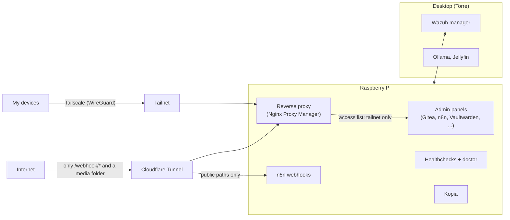
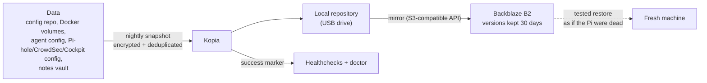
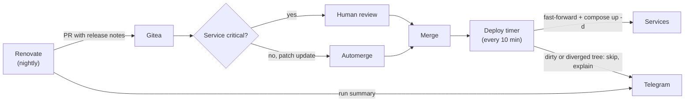

For a long time my homelab worked in the worst possible way: it worked. Containers ran, dashboards loaded, and I assumed everything was fine because nothing was screaming. Then I started asking uncomfortable questions. When did the last backup actually succeed? Which of my automations has been failing for a week? What happens if the SD card dies tonight?

I could not answer any of them with evidence. This post is about the work of turning a pile of services into something that watches itself, protects itself and tells me when it needs me. It runs on a Raspberry Pi and a desktop, so nothing here requires a data center budget.

## The setup

Two machines:

- **The Pi**: Raspberry Pi OS (Debian 13) on an SD card, running about 18 containers through Docker Compose. n8n, Gitea, Vaultwarden, Nginx Proxy Manager, Homepage, Healthchecks, CouchDB, Tandoor, Grocy, Portainer, cloudflared and a few small custom services. Outside Docker it runs Pi-hole for DNS, Tailscale, Cockpit, Kopia, CrowdSec and a Wazuh agent.
- **The desktop ("Torre")**: CachyOS. It is my development machine, runs local LLMs with Ollama and Jellyfin, and hosts the Wazuh manager in Docker.

The Pi is the server; the desktop is the workshop. Both are managed by the same principles, which I will walk through in the order a request or an attacker would meet them: access, observability, security, backups, updates.

## Layer 1: access, or how to have no open ports

The router forwards nothing except a WireGuard port. There are no port-forwards for 80 or 443, and the home IP never serves a web page to the internet.

Admin panels are only reachable from my tailnet. Tailscale gives each device a private address, and a reverse proxy (Nginx Proxy Manager) sits in front of the services with an access list that only allows tailnet addresses. From the LAN or from the internet, a panel answers 403. Internal DNS points the panel names at the Pi's tailnet address, and a wildcard TLS certificate obtained with a DNS challenge means I get proper HTTPS without ever exposing a validation endpoint.

One practical gotcha: after attaching an access list to a proxy host, I had to save the access list again before the rules were actually rendered in the proxy config. I only found out because the doctor script (more below) checks that every host really has its access list applied.

A homelab with zero public endpoints is not useful when you want webhooks or to share a file. The few public things go through a Cloudflare Tunnel, which makes an outbound connection from the Pi and so needs no inbound port. The tunnel is restricted by path: for the automation tool, only the webhook path is routed, and a separate hostname serves a read-only media folder. Everything else on those names returns nothing.

Why it matters: the attack surface is a short list I can recite. "What can the internet reach?" has a two-line answer.

## Layer 2: observability, because "nothing is screaming" is not a signal

This is the layer that changed the most.

### One inventory for every automation

Over time I had automations in six places: cron jobs, systemd timers, n8n workflows, scheduled tasks of my AI agent, and timers on the desktop. Nobody, including me, had the full list.

Now there is one inventory command that lists all of them with status, schedule and last run. Each entry has a short description in a registry file. If something new shows up without a description, it appears as `UNDOCUMENTED`, and that is a warning. The rule is simple: creating, changing or retiring an automation means updating its registry entry. The same inventory never deletes anything; it can only turn things off.

Each scheduled automation also gets a check in Healthchecks. When a run completes, it pings; if the ping does not arrive on schedule, Healthchecks notices the silence, which is the one failure mode that a script cannot report about itself.

### The doctor

A daily "doctor" script runs about a dozen checks and prints a pass/warn/fail line for each:

1. Reverse proxy hosts have their access lists applied.
2. No undocumented automations.
3. No failed Healthchecks checks.
4. The config repository has no drift (uncommitted or unpushed changes).
5. The last backup is recent.
6. TLS certificates are not close to expiring.
7. Disk and memory are within limits.
8. Every running service has a card on the dashboard.
9. No containers are stopped, unhealthy or restarting in a loop.
10. The Wazuh agent is connected to its manager.
11. OS updates and pending reboots.
12. The offsite backup succeeded.

On any FAIL it sends a Telegram message. Every Monday a weekly digest includes the WARNs too, so slow-burning problems (a certificate at 25 days, 60 pending updates) get seen without paging me at night.

The alerts go to a dedicated, outbound-only Telegram bot that does nothing else. My conversational AI assistant uses a different bot. That separation is deliberate: if I rotate or leak the chat bot's token, alerting keeps working, and a compromised assistant cannot silence the thing that watches it.

## Layer 3: security basics that actually get checked

Nothing exotic here, and that is the point.

- **UFW** with default deny on incoming traffic.
- **fail2ban** on SSH.
- **CrowdSec** with its community blocklist, which currently blocks about 1,900 IPs, plus local scenarios that detect behaviour on my own machines. Telegram is notified only for local decisions. The community list changes constantly and would turn the alert channel into noise within a day.
- **Wazuh** as a small SIEM, with agents on both machines and the manager on the desktop. A custom integration script sends alerts of level 10 or higher to Telegram.

Two findings were embarrassing and useful. First, my Wazuh install was still on factory default credentials. I rotated the admin, dashboard and API users, and moved the secrets out of the compose file into an `.env` file. Second, while auditing I found a token hardcoded in an old integration script. It was rotated immediately. The lesson was not "be more careful"; it was that a periodic read-only audit finds things memory never will.

## Layer 4: backups you have actually restored

A backup you have never restored is a hypothesis. I wanted 3-2-1: three copies, two media, one offsite.

Kopia takes nightly snapshots of what I could not rebuild from a clone: the config repository, Docker volumes, the AI agent's config, the Pi-hole, CrowdSec and Cockpit configuration, and my notes vault. Snapshots are encrypted and deduplicated, so a year of history is cheap. They land in a local repository on a USB drive, which is then mirrored to Backblaze B2. I used the S3-compatible API for that mirror, because Kopia's native B2 provider is deprecated. The bucket has a lifecycle rule that keeps deleted versions for 30 days, so a ransomware-style overwrite or an accidental delete can be undone.

Then I did the part most people skip: I restored from the cloud copy as if the Pi were dead, on a clean location, with nothing but what I would have in a real disaster.

That exercise taught me the key lesson. The two secrets that decrypt everything, the repository password and the cloud key, **must live outside the machine they protect**. If they exist only on the Pi, losing the Pi loses the offsite copy too, and it is useless. The twist: my password manager was itself running on that same Pi. I had built a backup whose keys were inside the thing being backed up. The recovery secrets now also exist offline, somewhere that does not depend on the Pi being alive.

## Layer 5: updates without a 4 a.m. surprise

My old setup was Watchtower, updating every container at 4 a.m. to `:latest`. It is convenient and it is also an unattended production deploy of unreviewed software, on a schedule I never looked at. Worse, its email notifications were broken, silently. So it failed in two directions: updating blindly, and not telling me when it did.

The new approach has four parts.

**OS patches are automatic, with deliberate exceptions.** `unattended-upgrades` installs security updates by itself. I excluded the Docker engine, kernels and the Wazuh agent on purpose. The agent must never be newer than the manager, and kernel or engine changes deserve a reboot I choose. Before turning this on, one supervised manual batch cleared roughly 225 pending packages, so the automation started from a clean baseline instead of a cliff.

**Images are pinned to exact versions.** I verified that each pinned tag resolved to the same digest already running, so pinning changed nothing at the moment I did it. It only made change explicit.

**Renovate opens the PRs.** A self-hosted Renovate runs nightly against Gitea and opens pull requests with release notes for new image versions. Patch updates of low-risk services automerge. Critical services (the password manager, the git server, n8n, the databases, the reverse proxy) always need a human review, and Postgres major versions are disabled completely. Each run posts a readable summary to Telegram.

**A tiny GitOps timer deploys merges.** Every ten minutes a timer on the Pi fast-forwards the config repository and runs `docker compose up -d`. If the working tree is dirty or has diverged, it skips the deploy and tells me why, rather than guessing.

Watchtower is on its way out. I did not delete it the moment the new pipeline worked; I let both exist until I trust the new one.

## The dashboard

Homepage is the front door, themed with my own brand. Every service has a card, and there is a Renovate card showing pending PRs. The doctor even checks that a running service has a card, so the dashboard cannot quietly fall behind reality.

## How I work with an AI agent

I operate this with an AI coding agent (Claude Code), but not freestyle. It follows a written runbook that behaves like a checklist:

- A backup before any edit to a config file.
- A closing sequence: snapshot the host state, commit, push, run the doctor.
- Every change tracked in a task document, so an interrupted session can resume.
- Secrets never pass through chat.
- Read-only audits first; changes second.
- Risky steps need my explicit approval.

The division of labour is plain. I decide; the agent executes and verifies. The runbook matters more than the model, because it is what makes a session end with the doctor green instead of with "should be fine".

## What I learned

The most valuable part of the whole exercise was not the tooling. It was the list of latent failures that recreating and checking things dragged into daylight.

**The container that could not be recreated.** After pinning images I recreated the containers, and CouchDB refused to start. Its entrypoint changes ownership of everything it touches, and a read-only bind-mounted config file was owned by the wrong user. The old container had only survived because nobody had ever recreated it. It was a time bomb that had been ticking since the day I first started it.

**The port that worked by luck.** The password manager's host port clashed with CrowdSec's local API on the same number. It had worked only because of boot order: whichever grabbed the port first won. Any reboot could have taken my password manager down, and the day I needed it most would have been a reboot day.

**A healthy container with no network.** An interrupted `compose up` left a container reporting "healthy" while attached to no network. The health check ran inside the container, so everything looked fine from within and nothing could reach it from outside. Health checks measure what you tell them to measure.

**Starting something that should be off.** `compose up -d` helpfully started a service I had stopped on purpose. The fix was a compose profile, so "intentionally off" is expressed in the file instead of in my memory.

**The free tier that would have blocked a real restore.** Cloud storage providers set default daily caps that match the free tier. My restore test exhausted them. In a real emergency, that cap would have blocked the very download I needed. The fix is to set a small spending cap instead of zero, so the failure mode costs a few cents rather than my backups.

**False warnings after every reboot.** The Pi's system journal is not persistent. A health check based on the last systemd run result therefore reported a false warning after every reboot, because the history was gone. I switched to a success marker file written by the job itself, which survives reboots and is easier to reason about.

**One writer for secrets.** I edited the `.env` file in my editor while a scripted change was adding a fresh token. Saving the stale editor buffer silently erased it. Nothing failed loudly; a token just was not there anymore. Files full of secrets should have a single writer at a time.

**Verify before you assert.** At one point I (the operator) claimed the router did not hand out a secondary DNS server. The DHCP options showed it did. A confident wrong statement is worse than "I don't know yet", and it applies to me as much as to the agent I work with.

## How to start your own

You do not need all of this. If I had to do it again on a Raspberry Pi budget, I would do it in this order, because each step makes the next one safer:

1. **Access through a VPN, with no open ports.** Tailscale or plain WireGuard, plus a reverse proxy that only allows the VPN. This removes the biggest class of risk for almost no money.
2. **Monitoring and alerts on what you already run.** Start with Healthchecks and a single Telegram bot. Even a simple "is the backup recent?" check is worth more than a dashboard you never open.
3. **Backups with a tested restore and an offsite copy.** Kopia, a USB drive and a cheap object-storage bucket. Test the restore, and keep the keys somewhere other than the machine.
4. **Security basics and default passwords.** A default-deny firewall, fail2ban on SSH, CrowdSec, and a real pass over everything still on factory credentials. Add a SIEM later if it interests you.
5. **Controlled updates.** Pin versions, let a bot propose changes, and keep a human in front of the services that would hurt if they broke.

Each layer here is small. What makes the whole thing feel like it runs itself is that every layer reports on its own health to one place, and that I have actually rehearsed the day it fails. The goal is not a homelab that never breaks. It is one that tells you, in plain language, before you find out the hard way.
