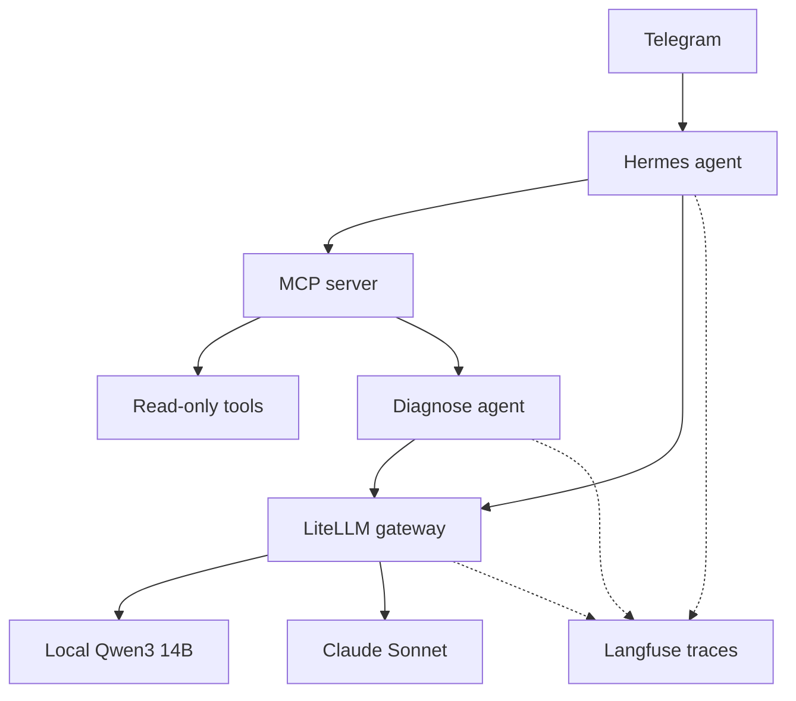
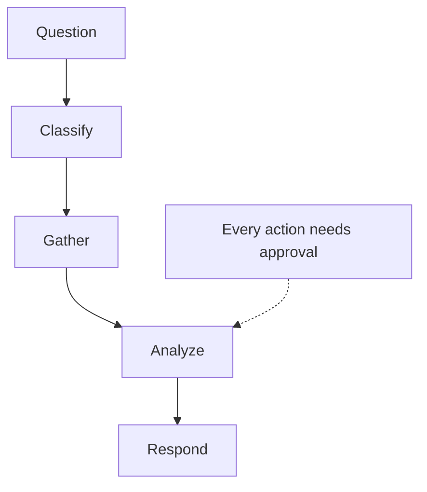

In the [previous post](/posts/my-homelab-stack-that-runs-itself/) I described a homelab that watches itself: a daily doctor script, one inventory of automations, backups with a tested restore, controlled updates. It tells me when something is wrong. What it does not do is answer questions.

"Is the last backup recent?" "Which automation failed this week?" "Did Renovate open anything I should review?" The answers exist, but they live in six different places, and finding them means opening a terminal. I wanted to type the question into Telegram, from my phone, and get an answer grounded in the real state of the machines, not in whatever a language model remembers from its training data.

This post covers how I built that, why I made the design choices I did, and the numbers that justify them. The numbers matter more than the architecture, because the main thing I learned is that with LLMs you should measure before you route and before you pay.

## The pieces

I did not build a new assistant. I already had one: Hermes, an agent I use through Telegram for notes and daily automation. What it lacked was a trustworthy way to see the homelab. So the work was in three layers:

1. **An MCP server** that gives any agent a small set of read-only tools.
2. **A diagnosis agent** built with LangGraph, exposed as one more tool on the same server.
3. **A gateway** (LiteLLM) so every model call goes through one place where I control which model answers and what it costs.

### MCP: tools instead of prompts

MCP (Model Context Protocol) is a standard way to hand tools to an agent. My server runs next to Hermes on the Pi, speaks over stdio, and is written in Python with the official SDK. The agent starts it as a subprocess, lists its tools and decides when to call them.

The tools are deliberately boring and all read-only. Each one wraps something that already existed:

- **Homelab status**: the output of the daily doctor script, as structured data.
- **Automations inventory**: every cron job, timer, workflow and agent task, with state and last run.
- **Pending Renovate pull requests**: what the update bot has proposed and is waiting for me.
- **AI costs**: spend per model, read from Langfuse and deduplicated.
- **Security decisions**: the local CrowdSec decisions, only what my own machines decided.
- **Backup status**: the latest snapshots and whether the offsite mirror is fresh.

Three rules apply to all of them. They never change anything. Secrets are read from the environment file at call time and never appear in tool output. And every subprocess and HTTP call has a timeout, so a slow dependency returns an error message instead of hanging the chat.

The tests call every tool through a real MCP client over stdio, the same way Hermes does. That check costs nothing because no language model is involved, and it caught more than one wiring mistake before the agent ever saw the tools.

## Why a LangGraph agent and not a free-form one

With tools available, the lazy design is a free-form agent: give the model the tool list and let it decide what to call, how often and in what order. It works in a demo. For something that looks at my infrastructure, I wanted the opposite: a short, fixed path I can reason about.

The `diagnose` tool is a LangGraph graph with four steps:

- **Classify**: decide which area the question is about (backups, automations, security, updates, costs, or general). This is a small job, so a small local model does it.
- **Gather**: call only the read-only tools relevant to that area. The model does not choose tools here; code does.
- **Analyze**: a stronger model gets the question and the gathered facts and returns findings, a probable cause and proposed actions.
- **Respond**: format the result for chat.

Two properties are enforced, and a third is checked, in code, not in the prompt:

- **Every proposed action is forced to `requires_approval: true`.** Even if the model says otherwise, the code overwrites it. And nothing is executed anyway: the agent proposes, I decide.
- **The classifier never falls back to a paid model.** If the local model is unreachable, a keyword heuristic takes over. A free degraded mode beats a surprise bill.
- **The output has a schema**, and the evaluation checks it on every run.

Compared with a free-form agent I lose flexibility. I gain predictability: the cost of a diagnosis is bounded, the failure modes are enumerable, and the trace in Langfuse always has the same four steps, which makes regressions easy to spot.

## Models routed by evaluation, not by hype

All model calls go through LiteLLM, which exposes a few aliases. Two matter here: `local` is Qwen3 14B running on the GPU of my desktop (free, fast, private), and `main` is Claude Sonnet (paid, strong). The mapping from task to alias did not come from a leaderboard. It came from running my own tasks.

Earlier I had run a 26-task evaluation of local versus cloud models on things I actually do. The results shaped the routing:

- **Local matched cloud on classification and extraction**, and lost on writing and code. So classification goes local, analysis goes to the cloud.
- **Gemini Flash turned out to be about 18 times more expensive per token than Claude Haiku 5.5**, which surprised me because "Flash" sounds cheap. Haiku scored 1.00 on the 19 items that can be scored automatically, for 0.0017 USD in total.
- **Qwen3 14B without thinking matched gemma3:12b in quality at half the latency.** With thinking enabled it also scored 1.00, but about 8 times slower. So I exposed both as separate aliases, and the default is the fast one.

None of this is a claim about which model is best. It is a claim about which model is best for these tasks on my hardware at these prices, which is the only claim that helps me decide.

## Evaluating the agent itself

Choosing models is half of it. The other half is knowing whether the agent works. I built a dataset in Langfuse, `ops-agent-v1`, with 21 questions in Spanish, the way I actually ask them, each with an expected area and the facts a good answer must mention.

I ran it in two phases so that most of the evaluation costs nothing.

**Free phase: classification.** The analyst is replaced by a stub, so only classification and the real read-only gathering run. Two classifiers compete on the same 21 questions:

- The local model got 0.86 (18 of 21).
- The keyword heuristic got 0.81 (17 of 21).

The interesting part is that they fail on different questions. The local model tends to say "general" when a question is phrased loosely. The keywords miss those too, but catch others the model gets wrong, such as a question about certificates that the model filed under security. Different failures suggest a combination.

So I added a simple ensemble: if the model says `general` but the keyword heuristic finds a specific area, trust the keywords. That is a few lines of code. Re-running the free phase, accuracy went from 0.86 to 0.95, and still costs nothing.

One caveat I keep in the notes: with 21 questions and a single run each, one question is about 5 points. This is good enough to pick a design and bad enough that I would not publish a ranking.

**Paid phase: full diagnoses.** Ten of the questions ran through the whole graph with Sonnet doing the analysis. I used deterministic checks only, no LLM judge:

| Check | Result |
|---|---|
| Output matches the schema | 10/10 |
| Every action requires approval | 10/10 |
| No invented tool names | 10/10 |
| Mentions the live facts it should | 10/10 |
| Correct area | 9/10 |

The one miss was routing, not analysis: the local classifier sent a question about pending update pull requests to "general", so the analyst only had the status report and honestly said it could not see the pull requests. That is exactly the case the ensemble now fixes.

A diagnosis cost about 0.014 USD and took about 7 seconds. The whole paid evaluation cost 0.137 USD, below a budget I had set in advance as a hard gate in the script. I also checked that the "mentions live facts" tests fail on wrong answers; a check that cannot fail is not a check.

What these checks do not measure is whether the proposed actions are wise. That still takes my judgment, which is why they all need approval.

## Cost lessons

Building the agent surfaced two expensive mistakes in the existing setup.

**Context that gets re-sent.** Hermes on Sonnet was costing about 0.07 USD per message. The reason was not the answer; it was the input. Every turn re-sent roughly 36,000 tokens of context (instructions, tool definitions, history) and nothing was cached. A short question paid for the whole prompt again. I enabled automatic cache-control injection at the gateway, so repeated prefixes should be billed at the cached rate. I do not have the result yet: at the time of writing the change is deployed but I have not collected enough traffic to say how much it saves, and I will not guess a number.

**The router that picked the priciest model.** I had an automatic "smart" router that, for hard prompts, picked the most expensive model available. Nobody decided that; it was a default. I capped the gateway so that the most expensive model it can reach is Opus.

Both are the same lesson. The cost of an AI system is set by defaults you did not look at, not by the model you chose on purpose. Putting a gateway in front of everything gave me one place where I can look.

## The rules I keep

These are short, and they are the part I would carry to any other project:

- **No paid test without asking.** Every evaluation has an estimate, a budget and a hard stop, and I approve the spend first.
- **Read-only tools.** An agent that can only look cannot break production at 3 a.m.
- **Secrets never in code.** They are read at call time, and I grep the outputs of every test run for anything that looks like a key.
- **Evaluate before routing.** Models are assigned to tasks by measured results, and re-assigned the same way.
- **Free first.** Design the evaluation so that most of it runs on the local model, and spend money only on what the free part cannot answer.

## What's next

- Measure the effect of prompt caching on real Hermes traffic and publish the actual number.
- Repeat the paid evaluation with several runs per question to get a variance, not just a point.
- Add the diagnosis tool to Claude Code, so I can ask the same questions from a terminal.
- Maybe, much later, let one narrow action run after approval. Not before the evidence says the proposals are consistently right.

The homelab already told me when it was unhealthy. Now I can ask it how it is doing, and the answer comes with data, a cost I can predict and a button that only I can press. That is the version of an AI agent I am comfortable running on my own infrastructure.
