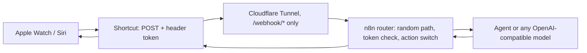

I tap "Jarvis" on my Apple Watch and ask what I bought at Decathlon. Thirteen seconds later Siri reads the answer from a receipt that arrived by email, went through OCR in Paperless and sits in a small search index on a Raspberry Pi.

This post covers how that works, what it costs, and the one design rule I ended up with: **the voice path can look at everything and change nothing.**

The reusable part is open source: [SaskullOps/homelab-ai-assistant](https://github.com/SaskullOps/homelab-ai-assistant).

{: width="720" }

## The path



- **Shortcut.** Dictate Text (or Ask for Input if you launch it with "Hey Siri"), then Get Contents of URL (POST, JSON with `action` and `text`, an `X-Siri-Token` header), then Speak Text. One Shortcut per action, all hitting the same URL.
- **Tunnel.** Only `/webhook/*` is public. The n8n editor is never exposed.
- **Router.** One webhook with a random path and a header token. A switch on `action` sends `ask` to the model, `status` to a homelab health summary and `wake` to a Wake-on-LAN hook for my GPU tower.
- **Agent.** In my setup it's [Hermes](https://hermes-agent.nousresearch.com/) behind LiteLLM, with a cheap model for voice. The public repo works with Ollama, LiteLLM or OpenAI directly.

## What it costs

From my logs and Langfuse traces:

| Request | Latency | Cost |
|---|---|---|
| Simple question | 3-8 s | about $0.002 |
| Question that searches my documents | about 13 s | about $0.002 |
| Confirmed action, big model, cold cache (includes my approval taps) | about 55 s | $0.11 |

My estimate for the last row was 1-3 cents. It was 11, because the bigger model loads a 41,000-token context the first time. Prompt caching makes the next one cost under a cent.

## "HomePod"

The first time I asked the Watch to restart a container called `homepage`, Siri heard "HomePod".

That settled the design. The voice path is read-only:

1. Over Siri the agent has web search, memory and my document search. No terminal, no files.
2. If I ask it to change something, it calls `propose_action`, which only stores a proposal.
3. A small Hermes plugin sends the proposal to Telegram with **Confirm** and **Cancel** buttons. Only my Telegram user id can tap them, each proposal works once and expires in 30 minutes.
4. On Confirm, the task runs in my Telegram session, where the agent has its tools and still asks before dangerous commands.

I cancelled the HomePod one, confirmed the right one, and `homepage` restarted.

## Things that broke on the way

- **"Make sure you have a valid URL".** I'd pasted only the base URL, without the random path.
- **"The network connection was lost".** The token had a trailing newline from copy-paste. iOS sent an invalid header and dropped the connection before n8n saw anything.
- **"I can't find Hermes in your contacts".** Siri reads "ask Hermes" as "message the contact Hermes". Name Shortcuts with something that isn't a first name.
- **Siri opened the Shortcuts app.** That happened when I launched it with "Hey Siri" and the Shortcut started with Dictate Text. Ask for Input keeps a voice launch inside Siri; tapping the Shortcut works fine with Dictate Text, which is what I use now.
- **The agent answered without searching.** Hermes hides MCP tools behind a tool search, and its system prompt was stale. Naming the tool and the exact call shape in the prompt fixed it.
- **The plugin said "running" when nothing ran.** Hermes refused the injected task because one field of the chat origin was missing. The plugin now copies the stored origin and edits the message if Hermes refuses.

## What the security review found

Before publishing I asked an independent reviewer to read the repo cold. No data leaked, but it found real issues:

- n8n stored every execution, **including the token header**. Turning off saving wasn't enough on 2.44.3; pruning had to be off too, and I checked the database to confirm zero rows.
- The example Wake-on-LAN hook could be held open by a slow client. It now has a hard runtime limit.
- My troubleshooting tip exposed Ollama to the whole LAN. It now binds to the Docker bridge.

The repo also pins the n8n image by digest, keeps the token out of process arguments, and a fresh clone passes all eight checks against a local model.

## Try it

```bash
git clone --branch v0.1.0 https://github.com/SaskullOps/homelab-ai-assistant.git
cd homelab-ai-assistant/modules/siri-voice-bridge
cp .env.example .env && chmod 600 .env
docker compose up -d
./scripts/import.sh && ./scripts/test.sh
```

Then follow the Shortcut guide in the repo. Next in the series: the document search on the Pi, and why I turned off the reranker after measuring it.
